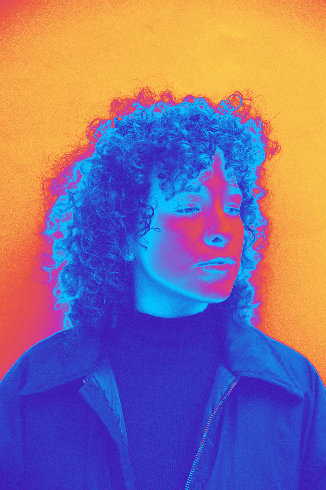

# Sobre mí

{ width="250" style="display: block; margin-left: auto; margin-right: auto;" }

Soy Lucía Arreche Del Sur, diseñadora industrial con orientación textil y docente universitaria.

Mi práctica se desarrolla entre el diseño, la educación y la exploración de procesos creativos y materiales. Me interesa especialmente el vínculo entre el pensamiento y el hacer, así como las posibilidades que surgen del encuentro entre distintas disciplinas, herramientas y formas de conocimiento.

Actualmente curso la Especialización en Fabricación Digital e Innovación Abierta de UTEC, un espacio desde el que busco incorporar nuevas herramientas y explorar sus posibilidades dentro de mi práctica.

PHASIS nace como una bitácora para documentar ese recorrido: registrar experiencias, preguntas, ensayos, dificultades y descubrimientos que aparecen durante el aprendizaje.