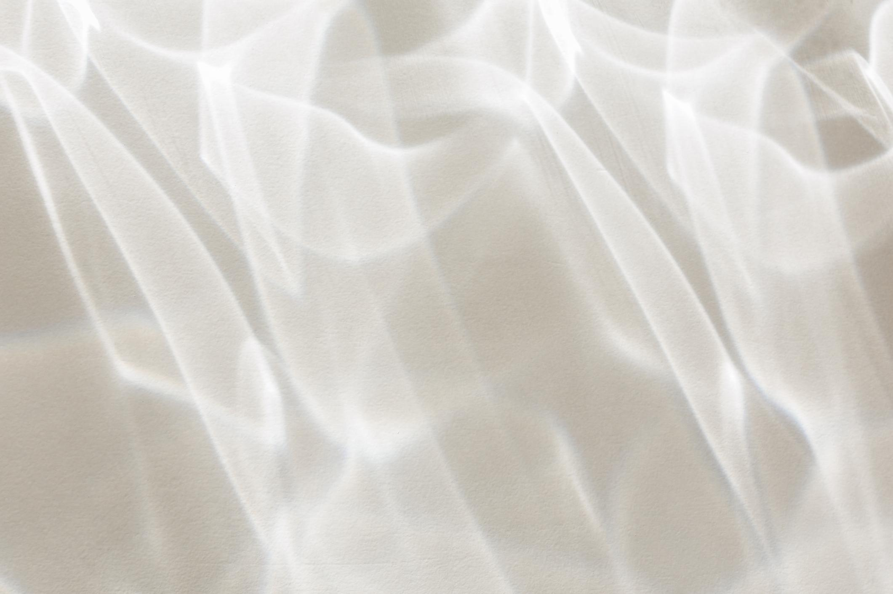

# MI01 — Innovación abierta y distribuida

*Primeras aproximaciones · Octubre de 2026*

## 01 / Aproximación

Este módulo propone explorar modelos de innovación abierta y diseño distribuido, considerando las posibilidades de colaboración, acceso al conocimiento y participación de diferentes actores en los procesos de diseño.

En las clases se presentaron experiencias y proyectos que permiten pensar la innovación más allá del desarrollo individual de productos, incorporando dimensiones abiertas, colaborativas, regenerativas y ecosistémicas.

## 02 / El ejercicio: Mekanika

Como parte de las actividades del módulo, trabajé sobre **Mekanika**, un proyecto de fabricación digital con sede en Bruselas que desarrolla máquinas y recursos orientados a facilitar el acceso a estas tecnologías.

A través de un tablero de Miro, el ejercicio consistió en analizar tres preguntas:

- ¿Para quién genera valor el proyecto y quiénes quedan fuera?
- ¿Cómo se genera ese valor?
- ¿Qué posibilidades existen para ampliarlo?

[Ver o descargar la entrega en PDF](../pdf/Entrega_MI01_LuciaArreche.pdf)

!!! para-mi "Nota para mí"
    Me interesa explorar las posibilidades de la fabricación digital en el sector textil y de la indumentaria local.

    Por ahora, mi aproximación está centrada en conocer las herramientas, comprender qué permiten hacer y empezar a reconocer las condiciones necesarias para incorporarlas en contextos productivos concretos.

    El ejercicio también abre preguntas sobre las posibilidades de intercambio entre diseñadores, productores y otros actores del sector.

## 03 / Apuntes de clase

5 de octubre de 2026 · Diseño distribuido e innovación abierta

- La innovación abierta como una forma de creación que promueve futuros abiertos, colaborativos y regenerativos.
- La responsabilidad compartida de las comunidades en el uso de materiales y procesos.
- La importancia de crear comunidades alrededor de los proyectos.
- La documentación como recurso para compartir conocimientos y favorecer su continuidad.

## 04 / En proceso

Quedan pendientes algunas lecturas y reflexiones para ampliar esta primera aproximación al módulo.

{ .phasis-refraccion }