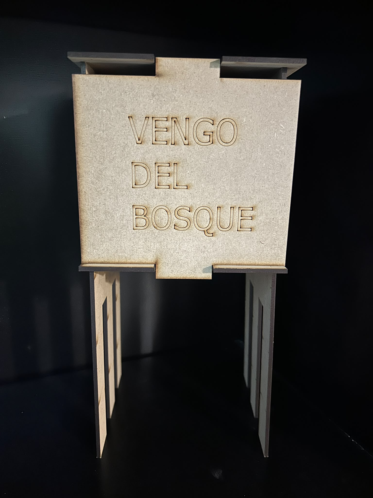

# 

## 03 / Del modelo al material

El proceso comenzó con el modelado tridimensional en Fusion, utilizando parámetros para definir las dimensiones de las piezas y sus encastres. Esta forma de trabajar permite establecer relaciones entre las medidas, de modo que las modificaciones del diseño puedan actualizarse de manera vinculada.

Una vez desarrollado el modelo, el siguiente paso fue trasladar las piezas a un formato vectorial bidimensional. Para ello utilicé Inkscape, organizando los contornos y las distintas operaciones necesarias para la fabricación.

Finalmente, el archivo se preparó en RDWorks, donde se diferenciaron las operaciones de corte vectorial, marcado vectorial y grabado rasterizado. En esta etapa también se configuraron los parámetros de velocidad y potencia para trabajar con la máquina de corte láser.

{ width="65%" }

## 04 / Aprendizajes del proceso

Uno de los principales aprendizajes surgió durante la preparación del archivo para el corte láser. Al modificar la escala del diseño en RDWorks, también se modificaron las dimensiones de las ranuras que había definido previamente en Fusion.

Como consecuencia, las piezas cortadas no conservaron las relaciones dimensionales necesarias para ensamblarse correctamente.

Esta experiencia me permitió comprender que el escalado de un archivo vectorial no equivale a modificar los parámetros del modelo original. Mientras que en Fusion es posible establecer relaciones entre dimensiones, en RDWorks el escalado afecta proporcionalmente a toda la geometría, incluidos los encastres.

!!! para-mi "Nota para mí"
    Antes de modificar las dimensiones de un archivo para fabricación, es necesario revisar cómo esos cambios afectan las medidas funcionales de las piezas. En diseños por encastre, el espesor del material y el ancho de las ranuras deben conservar su correspondencia.

## 05 / Apuntes de clase y laboratorio

**Modelado paramétrico · Fusion**

- Los parámetros permiten establecer relaciones entre las dimensiones de las piezas.
- Diferenciar las medidas que se definen como decisiones de diseño de aquellas que se calculan a partir de otras.
- Realizar croquis previos para comprender la geometría y los encastres.
- Utilizar expresiones matemáticas para vincular dimensiones.

**Corte láser · Laboratorio**

- El punto focal influye en la precisión del corte: un haz bien enfocado produce una línea más fina.
- La velocidad y la potencia se ajustan según el material y la operación.
- El corte suele requerir velocidades menores que el marcado o grabado.
- En el rasterizado, el intervalo determina la separación entre las líneas de barrido.

**Preparación y operación de la máquina**

- Verificar el sistema de enfriamiento y la asistencia de aire.
- Comprobar la altura de enfoque y la posición del material.
- Transferir el archivo mediante pendrive.
- Definir el origen del trabajo.
- Utilizar *Frame* para comprobar el área de trabajo antes de iniciar.
- Ejecutar el trabajo mediante *Start*.

**RDWorks**

- Configurar las dimensiones del área de trabajo en *Page Settings*.
- Organizar las operaciones mediante capas.
- Definir velocidad y potencia para cada operación.
- Revisar el orden de ejecución de las capas y la optimización del corte.

## 06 / Archivos de fabricación

Como parte del proceso de fabricación, se generaron
archivos vectoriales para preparar las operaciones
de corte y grabado láser.

Estos archivos forman parte del registro técnico
del ejercicio y permiten documentar el pasaje
del diseño digital a su materialización.

[↓ Consultar la premisa del ejercicio (PDF)](../files/MT03/mt03-premisa.pdf)